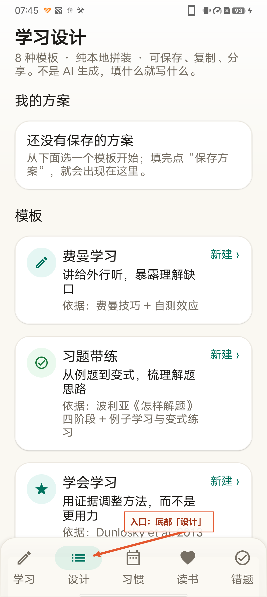
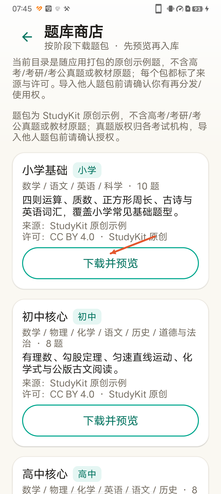
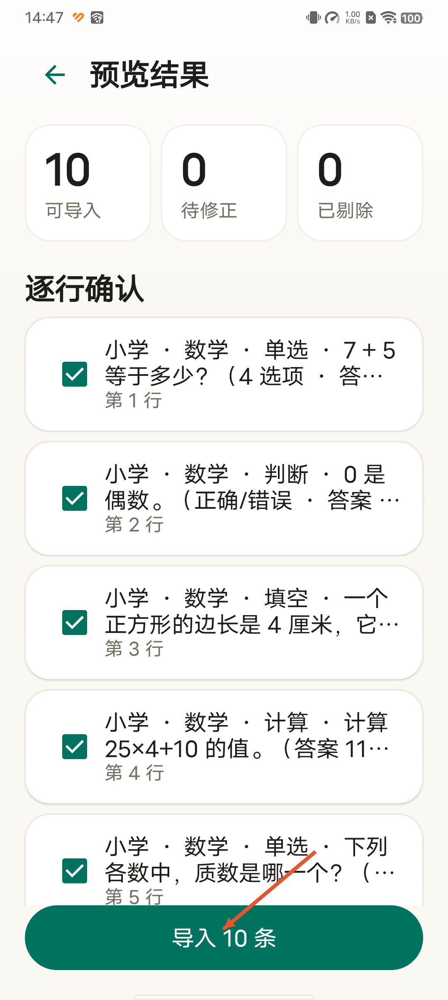
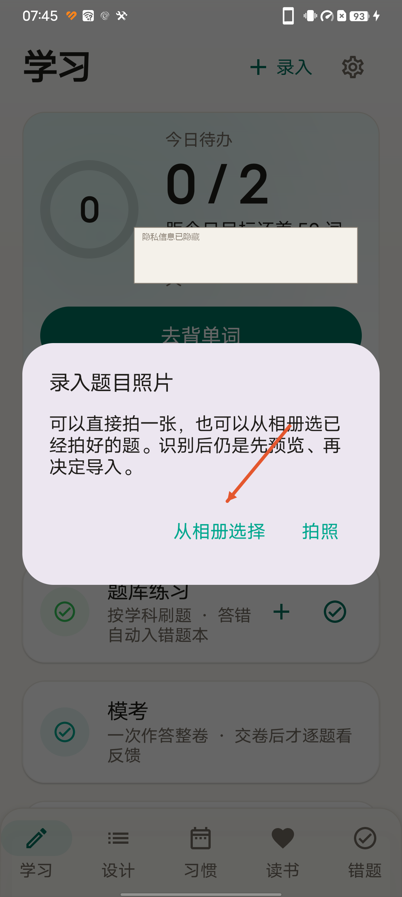

# StudyKit 3.4 使用教程（图解）

> 截图来自 3.4.1 真机（vivo V2156A / Android 11）。考试倒计时等个人信息已用色块遮住，
> 每张图用橙色箭头指向操作入口。应用内「设置 → 使用教程」也内置了同一组图。

## 1. 设计 Tab：8 种学习/教学模板

- 底部「设计」进入；先看到「我的方案」，下面是 8 张模板卡。
- 点「新建」填字段，所有带 `*` 的必填项填完后，下方实时生成 Markdown 预览。
- 方案可保存到本机、整份复制、系统分享；不调用模型，断网也能用。

## 2. 题库商店：按阶段下载题包

- 题库练习 →「题库商店 · 按阶段下载题包」。
- 当前 6 个包：小学 / 初中 / 高中 / 大学 / 考研 / 考公；每个包标出来源与许可。
- 点「下载并预览」后不会直接写库。

## 3. 先预览，再入库

- 预览页逐行勾选；确认「导入 N 条」后才写进题库。
- 重复题按「题干 + 选项 + 阶段 + 题型 + 学科」跳过，不会静默丢坏行。

## 4. 拍照 / 相册录题

- 学习 / 题库 →「＋录入」→「拍照 / 相册录题」；错题本 →「拍照 / 相册」。
- 相册走系统照片选择器，不需要存储权限。
- 识别出「题干|选项|答案」就进预览；没有分列就进题库编辑页补竖线，
  **不会自动切到错题本**。

## 隐私与截图规范

- 截图前先切到不含个人数据的画面；无法避开时，把考试名称、倒计时、题目标题等
  用实色块遮住，并在色块内标「隐私信息已隐藏」。
- 箭头统一橙色 `#E4572E`，只指向一个操作入口；一张图最多一条箭头，避免讲不清重点。
- 图片原文件在 `docs/tutorial/`，生成脚本 `docs/tutorial/annotate.ps1`；
  重新截图后按同一坐标重画即可。
